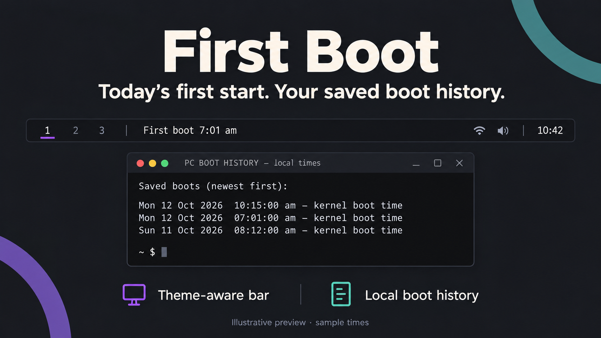

# First Boot

**A small desktop reminder of when you first started the computer today.**

It keeps that first time visible even if you reboot later. Hover to see today's
boots, or click to browse the saved history. It tracks actual computer boots,
not login sessions or waking from sleep. Everything stays on the computer.

Public source release under the MIT licence. Personal boot records and desktop
configuration are not included. Marketplace submission is being prepared;
this is not yet a marketplace-approved release.



The preview is an illustration using fictional times, not a screenshot of
someone's activity. Colours follow your desktop rather than the preview palette.

Shows **First boot 7:01 am** immediately after the workspace numbers on the bar. Hover for every boot today. Click to open the saved history in Ghostty; press Enter to close it.

The first time stays unchanged through subsequent reboots. A machine left running overnight shows **No boot today**. Suspend/wake and logging in again do not count as new boots. Times follow the machine's local timezone, including daylight saving changes. Boot time records when the PC started; it does not track other activities.

## Install, update, remove

Requires Omarchy Quattro with its shell, Python 3 (standard library SQLite),
systemd user services, journalctl and Ghostty for the history window. No pip
packages, account or API key are needed.

**Manual setup is required.** The installer enables a user-level boot recorder
and puts the widget after the workspaces on the stock bar. It targets
`bar.layout.left` in `shell.json`; custom bars such as Shibumi need a separate
placement review. Do not run this installer against an incompatible layout.
Simply downloading/enabling the widget does not install its recorder timer.

Clone the source and review the installer before running it:

```sh
git clone https://github.com/shaggyrs6-netizen/omarchy-first-boot.git
cd omarchy-first-boot
python3 manage.py install
```

For subsequent maintenance, from this folder:

```
python3 manage.py update
python3 manage.py verify
python3 manage.py remove --confirm-remove
```

Install refuses an existing installation. Update changes only this plugin's five files, its two user service files, and its bar entry; backups are kept first. Remove deletes those same owned files and bar entry, preserving the log and backups. It leaves unrecognised files intact. Neither path restores an old full shell configuration over later customisations.

The installed manager is `~/.config/omarchy/plugins/shaggyrs6.first-boot/manage.py`. To update from a newer bundle, run the newer bundle's manager.

## Persistence and recovery

- Local SQLite ledger: `~/.local/state/first-boot/boots.sqlite3` (or `$XDG_STATE_HOME/first-boot`). One row per kernel boot ID, with atomic transactions and full synchronous commits. No network or added dependencies.
- The user's `first-boot.timer` starts at login and records every minute independently of the bar. The widget reads it every 30 seconds and visibly flags stale/failed reads.
- Current boot time comes from the kernel. Existing journal history is imported once per boot ID. Early journal timestamps are adjusted by their monotonic timestamp; if no early entry survives, the first available entry is explicitly marked approximate.
- The journal recovers boots that occurred without logging in, provided their records still exist and are readable. A boot never recorded locally and already removed from the journal cannot be recovered.
- History is retained; rows are tiny. No daily files to manage, no destructive automatic pruning. A broken ledger is left intact and produces a visible error rather than silently replacing history.
- PC clock accuracy governs boot-time accuracy. A later timezone change displays historical instants in the new local timezone.

## Historical overview

Click the bar label to open the saved boot history in Ghostty. It shows today's
first boot and subsequent reboots, followed by all saved boots, newest first.
Each historical entry includes its date, local time with seconds, timezone and
record source. Imported journal entries are marked approximate when an exact
start cannot be inferred. Press Enter to close the window.

This is a boot log, not an activity tracker. It does not measure time spent
working, record shutdown times, or count waking from sleep as a new boot.

## Themes and fonts

The widget uses Omarchy's native `WidgetButton`, inheriting the host bar's
foreground colour, font family and tooltip presentation. Font size follows
`Style.font.body` at a 1.15 multiplier for readability; no fixed palette or font
family is embedded. The history window is plain text and follows your Ghostty
theme and font settings independently of the bar.

## Licence and tests

MIT, copyright 2026 Lee Shand. See [LICENSE](LICENSE).

Run `python3 -m unittest discover -s tests -v` for isolated boot-display and
theme-contract checks. These tests do not read or change your personal ledger,
install services, switch themes, or reboot the machine. See
[RELEASE-CHECKS.md](RELEASE-CHECKS.md) for the scope of the theme review.

## Actual reboot check

Before restarting, save your work normally. After the next reboot and login, allow up to one minute and run:

```
python3 ~/.config/omarchy/plugins/shaggyrs6.first-boot/manage.py verify
```

Check that `reboot_verified` is `true`, the bar still sits after the workspace numbers, and hovering lists the new boot while retaining today's first time. `true` means a different actual kernel boot ID has been persisted since installation; restarting the bar cannot satisfy it. A new calendar day correctly starts a new first time.

No restart is performed by this installer. A real reboot remains unverified until this check succeeds.
